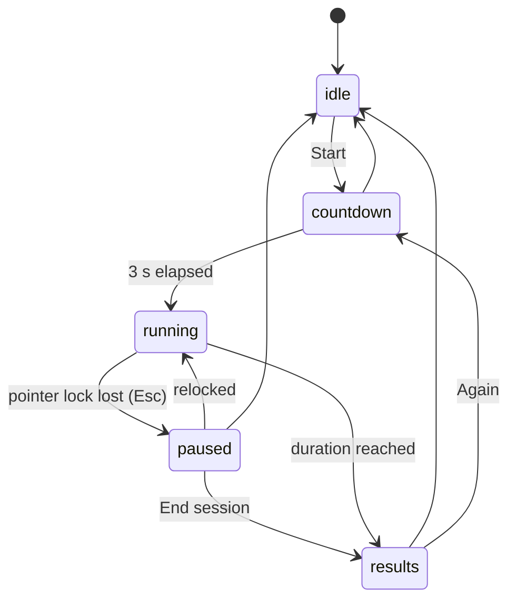
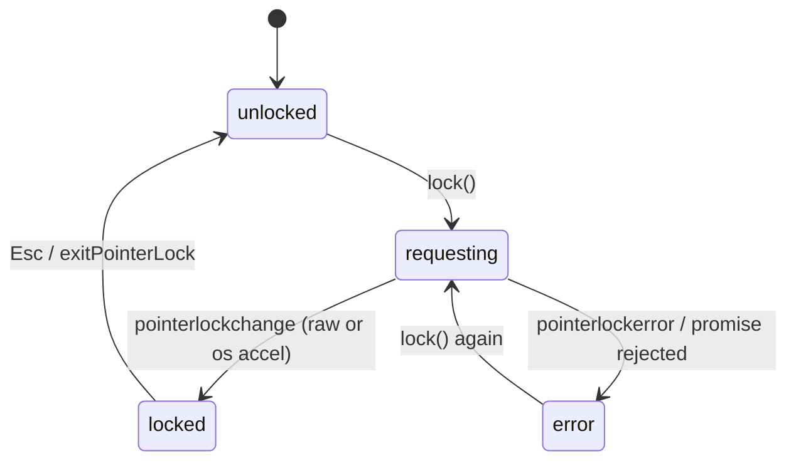
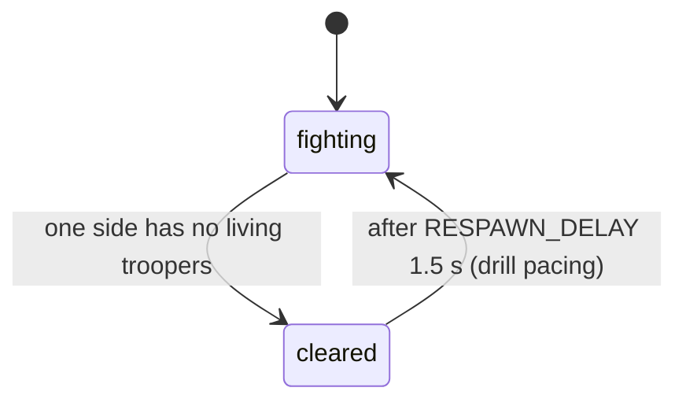
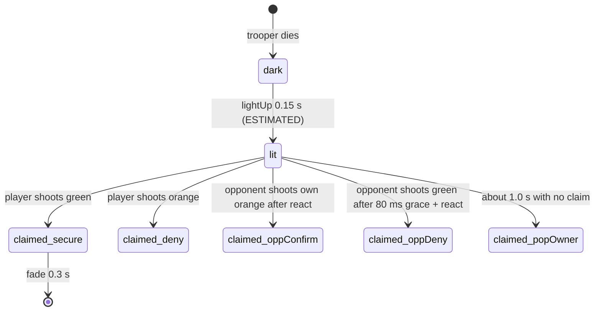
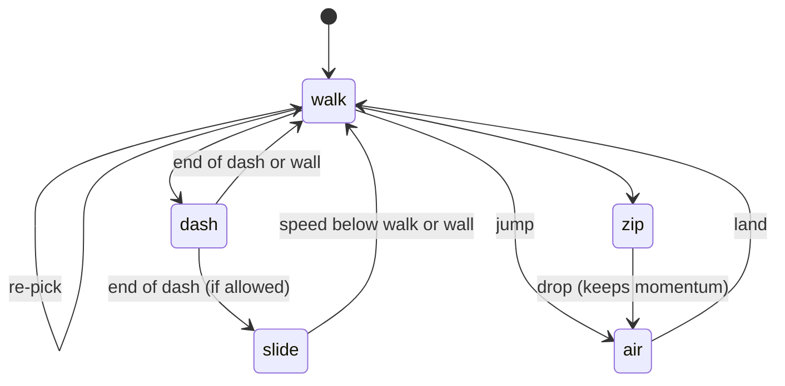

# State machines v1

Implicit states found during review, now explicit in code. Diagrams are Mermaid.

## 1. Session phases (core/session.ts)

Transitions are a whitelist table; illegal calls return false. Sim time only advances in `running`, and the last frame is clipped so a session gives exactly `durationS` of sim time.
Bug fixed: v1 drills ran forever with no end, no pause on lost lock, and scored time while unlocked.

## 2. Pointer lock / input (core/input.ts)

Mouse counts and clicks are only accepted in `locked`. Bug fixed: v1 accepted clicks when unlocked and applied each mousemove immediately instead of once per frame.

## 3. Wave (drills/deadlock-souls/sim.ts)

Bug fixed: v1 respawned instantly in the same frame, so surviving troopers were wiped while their orbs were still in flight.

## 4. Floating orb lifecycle (drills/deadlock-souls/sim.ts)

Shots at `dark` return early, at `claimed` return late. Bugs fixed: v1 counted a popped green orb as "missed" although the wiki says it is auto-awarded to the owner; v1 could not tell secure from deny in history.

## 5. Mover (drills/deadlock-tracking/mover.ts)

Transitions are a table; illegal requests are counted (`illegal`, saved in results, 0 in the 60k step test). Bugs fixed: v1 zipline ended by teleporting from 3 m to the ground; v1 kept dashing into the wall with zero speed until the timer ran out.

## 6. App route (core/app.ts)
hub <-> souls <-> tracking by URL hash. Leaving a drill disposes it: stops its rAF loop, exits pointer lock, removes DOM. Bug fixed: v1 pages never stopped their loops (one page per drill, so it never mattered, but a single mount needs it).
