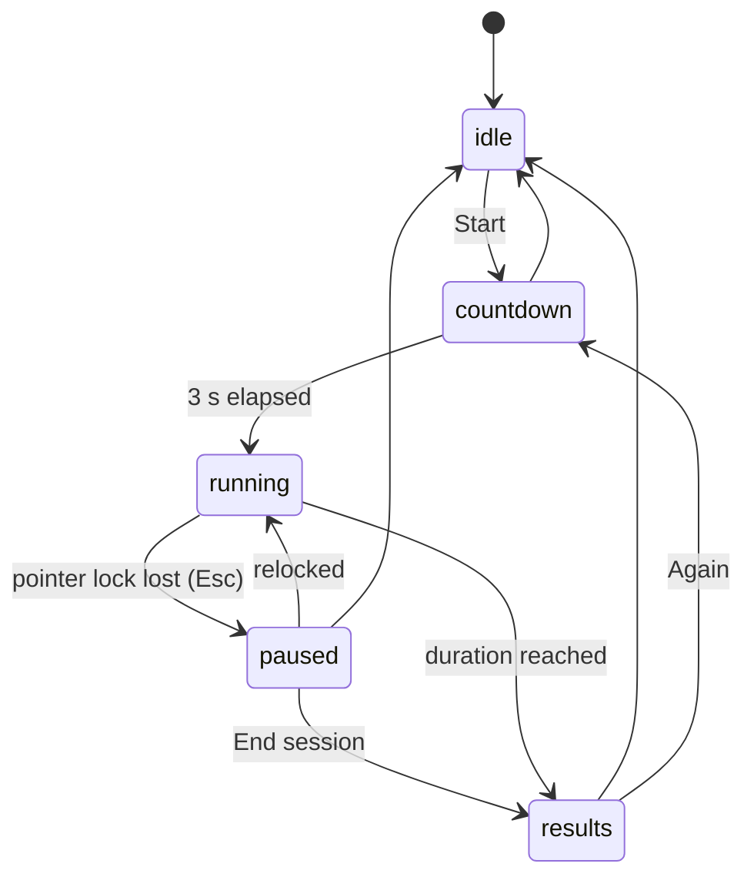
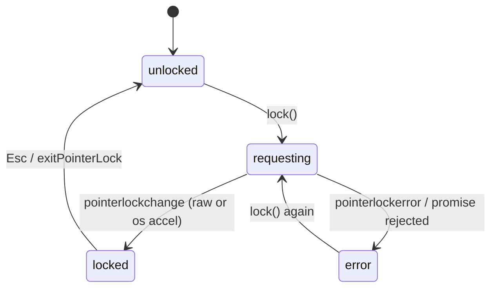
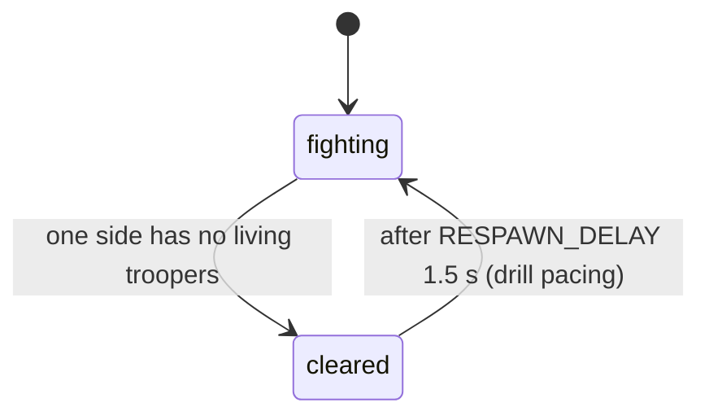
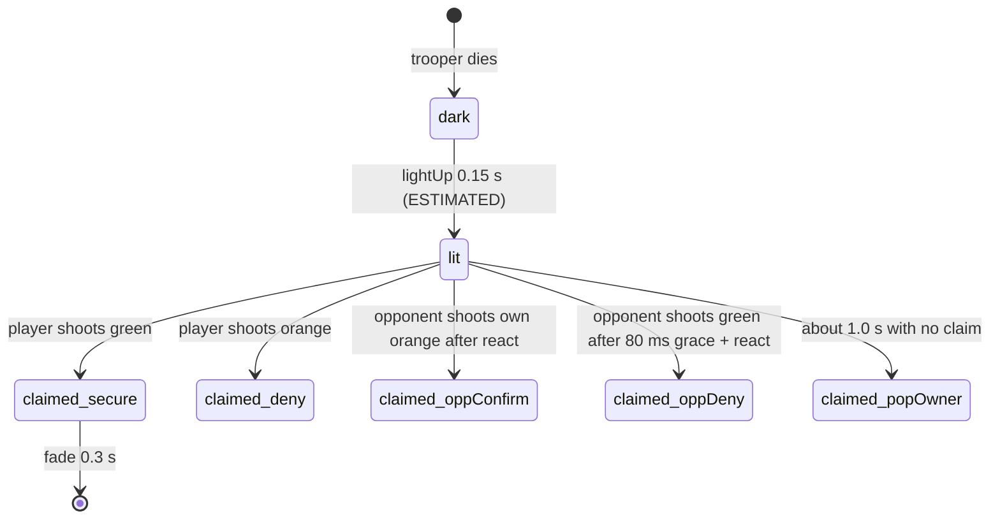
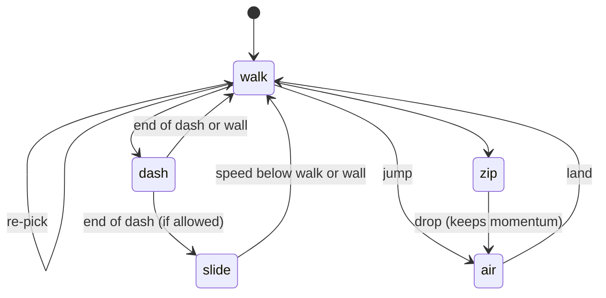
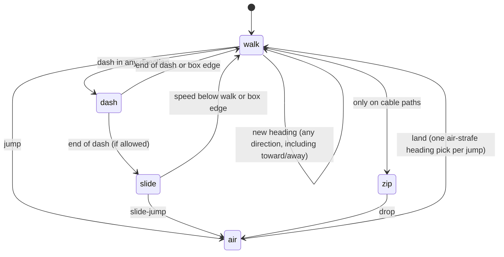
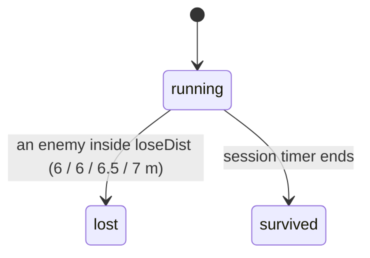
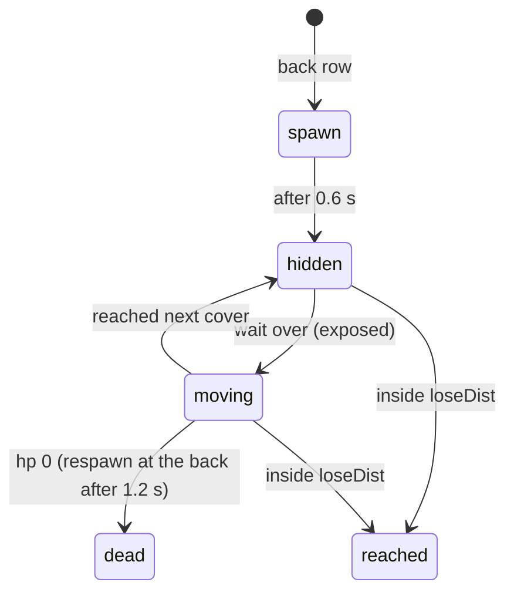
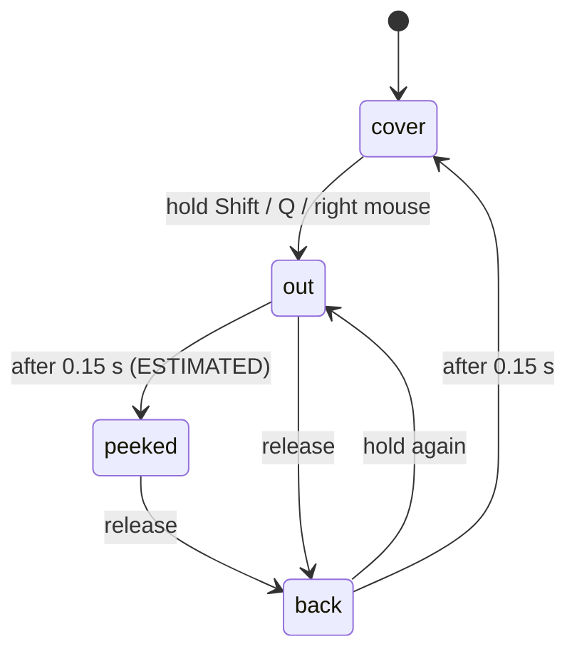

# State machines v2

Implicit states found during review, now explicit in code. Diagrams are Mermaid.

## 1. Session phases (core/session.ts)

Transitions are a whitelist table; illegal calls return false. Sim time only advances in `running`, and the last frame is clipped so a session gives exactly `durationS` of sim time.
Bug fixed: v1 drills ran forever with no end, no pause on lost lock, and scored time while unlocked.

## 2. Pointer lock / input (core/input.ts)

Mouse counts and clicks are only accepted in `locked`. Bug fixed: v1 accepted clicks when unlocked and applied each mousemove immediately instead of once per frame.

## 3. Wave (drills/deadlock-souls/sim.ts)

Bug fixed: v1 respawned instantly in the same frame, so surviving troopers were wiped while their orbs were still in flight.

## 4. Floating orb lifecycle (drills/deadlock-souls/sim.ts)

Shots at `dark` return early, at `claimed` return late. Bugs fixed: v1 counted a popped green orb as "missed" although the wiki says it is auto-awarded to the owner; v1 could not tell secure from deny in history.

## 5. Mover (drills/deadlock-tracking/mover.ts)

Transitions are a table; illegal requests are counted (`illegal`, saved in results, 0 in the 60k step test). Bugs fixed: v1 zipline ended by teleporting from 3 m to the ground; v1 kept dashing into the wall with zero speed until the timer ran out.

## 6. App route (core/app.ts)
hub <-> souls <-> tracking by URL hash. Leaving a drill disposes it: stops its rAF loop, exits pointer lock, removes DOM. Bug fixed: v1 pages never stopped their loops (one page per drill, so it never mattered, but a single mount needs it).

## 7. Session end by the drill (core/shell.ts, v2)
A drill may expose `ended()`. While the session is `running`, the shell checks it every frame and goes `running -> results` when it returns true. Cover fire uses this for a loss. No new session states.

## 8. Free movement (core/freemove.ts, #51)
Replaces the on-rails mover for every tracking level. Targets move on a plane (along the path, across it) inside a box, plus height.

Box: half path length along, `lat` across (default 2.5 m; 1.5 m on the ledge, 1 m on the ramp, 3 m on the bridge lane). Hitting an edge clamps, turns inward, and ends a dash or slide.
Spec numbers: walk 6.4 m/s, dash peak and duration by bucket, jump 295 u/s, air accel 15 / 5 above 450 u/s, zipline 18 m/s.
ESTIMATED: per-second rates of heading changes, dashes, jumps and zips by difficulty (`FREE_RATES`, all rising Easy to Pro), walk accel 40 m/s^2, air-strafe pick at 0.15 to 0.45 s into the jump.
The Classic/Realistic movement profile no longer changes tracking targets (it only fed the old rails mover).

## 9. Cover fire round (drills/deadlock-cover-fire/sim.ts, #43)

## 10. Cover fire enemy

Damage lands only in `moving`. While moving, an enemy strafes, steps back, jumps and dashes in any direction (forward-biased), always heading for the next cover and kept inside |x| <= 10 m. Illegal requests are counted and saved (`illegalTransitions`).

## 11. Cover fire peek (player)

Only `peeked` can shoot. The peek side is fixed per round (random left or right); the wall blocks the other side by geometry.
